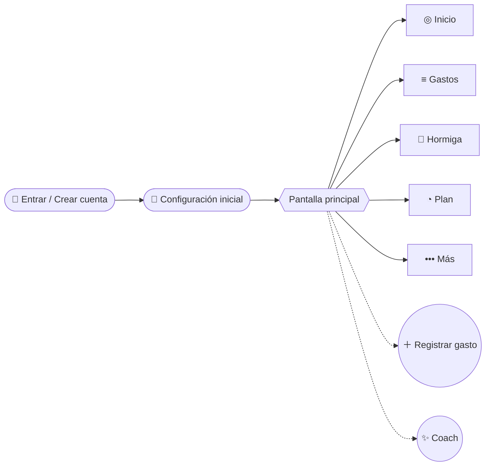
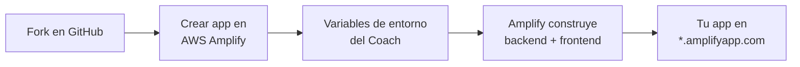
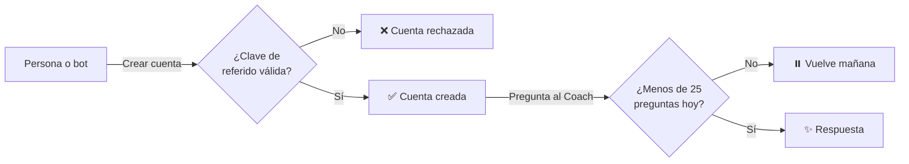
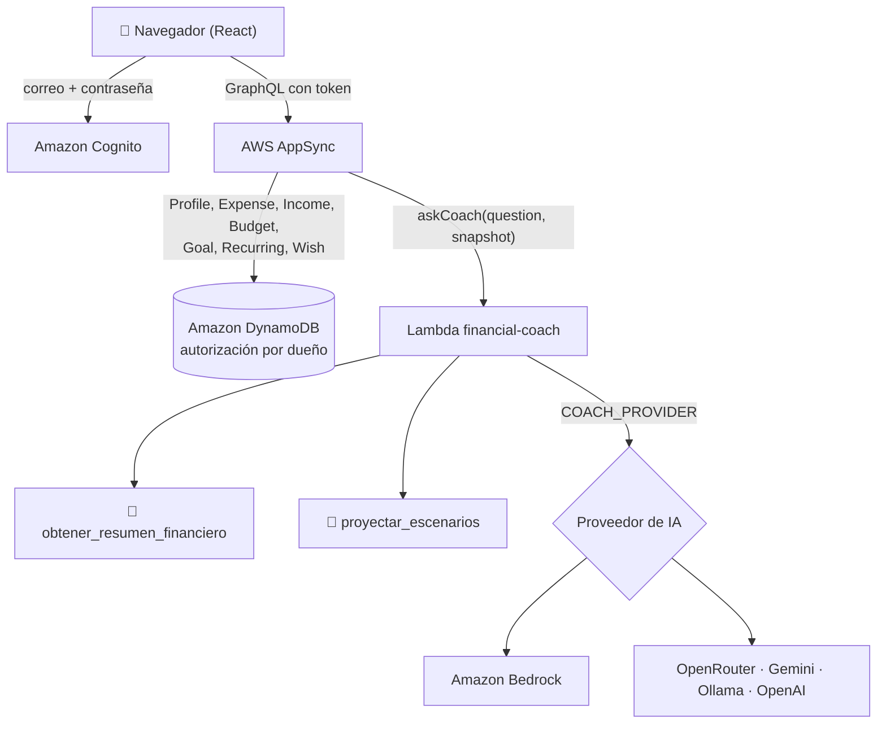
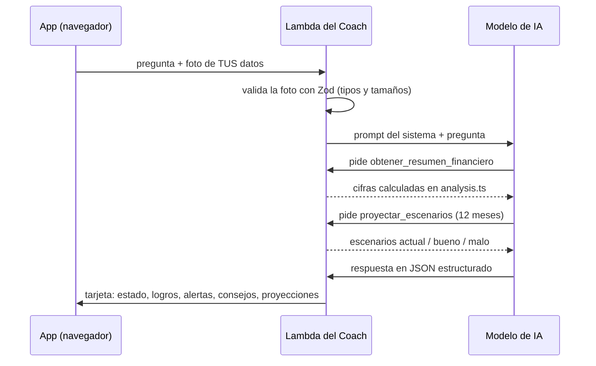

<div align="center">

# 🐜 Gastos Hormiga

**Descubre a dónde se va tu dinero y recupéralo.**

Una app web para registrar tus gastos en dos toques, detectar los gastos pequeños que se repiten (los *gastos hormiga*) y recibir consejos de un Coach con IA basados en tus propios números.


[Cómo usarla](#-guía-de-uso) •
[Tu rutina](#-cómo-aprovecharla-en-tu-día-a-día) •
[Desplegar con Amplify](#-despliega-tu-propia-copia-con-aws-amplify) •
[Quién se registra](#-controla-quién-puede-registrarse) •
[Proveedores de IA](#-elige-el-proveedor-de-ia-del-coach) •
[Arquitectura](#-arquitectura)

</div>

---

## 💡 ¿Qué es un gasto hormiga?

Son gastos chicos que se repiten sin que lo notes: el café de cada mañana, el antojo en la tiendita, el delivery "porque no hay nada en casa". Uno solo parece poca cosa, pero juntos se comen tu quincena.

```
☕ $55 al día  ×  365 días  =  $20,075 al año
                            ≈  178 horas de tu trabajo (con un ingreso de $18,000 / 160 h al mes)
```

Gastos Hormiga hace esa cuenta **con tus datos reales**, sin conectar tu banco.

---

## 📱 Guía de uso

### El mapa de la app



Así se ve la pantalla principal. Los dos botones flotantes están siempre a la mano, sin importar la pestaña:

```
┌──────────────────────────────────┐
│  Hola, Ana                       │
│                                  │
│      (contenido de la pestaña)   │
│                                  │
│                        ┌──────┐  │
│                        │✨Coach│ ← pregunta a tu Coach con IA
│                        └──────┘  │
│                           ( + )  │ ← registra un gasto
├──────────────────────────────────┤
│  ◎      ≡      🐜      ◔    •••  │
│Inicio Gastos Hormiga  Plan  Más  │ ← barra de pestañas
└──────────────────────────────────┘
```

---

### Paso 1 · Crea tu cuenta

1. En la pantalla de bienvenida, toca **Crear cuenta**.
2. Escribe tu **correo**, una **contraseña** y la **Clave de referido** que te compartió quien administra la app.
3. Revisa tu correo: te llega un **código de 6 dígitos**. Escríbelo para confirmar que el correo es tuyo.
4. Listo. Las siguientes veces entras con **correo y contraseña** en la pestaña **Entrar** (la clave de referido sólo se pide al crear la cuenta).

```
┌───────────── Crear cuenta ─────────────┐
│ Email:              [tu@correo.com]    │
│ Contraseña:         [••••••••]         │
│ Confirmar:          [••••••••]         │
│ Clave de referido:  [HRM-XXXXXXXX]     │ ← sin ella no se crea la cuenta
│            [ Crear cuenta ]            │
└────────────────────────────────────────┘
```

> [!TIP]
> ¿Olvidaste tu contraseña? Toca **¿Olvidaste tu contraseña?** y te llegará otro código al correo para crear una nueva.

> [!NOTE]
> Tus datos son privados: cada cuenta sólo puede ver y editar sus propios registros.

---

### Paso 2 · Configuración inicial (sólo una vez)

La pantalla **"Hola, empecemos"** te pide unos datos para que la app calcule cuánto te cuesta cada hábito **en horas de tu vida**. Todo se puede cambiar después en **Más → Perfil**.

| Campo | Qué escribir | Para qué se usa |
|---|---|---|
| **¿Cómo te llamas?** | Tu nombre o apodo | Para saludarte |
| **Ingreso mensual aproximado** | Lo que ganas al mes, en pesos | Calcular cuánto tienes disponible |
| **Tu ingreso es…** | `Fijo` o `Variable / freelance` | Con ingreso variable, la app usa lo que registres como ingreso real |
| **Te pagan / te organizas por** | `Semana`, `Quincena` o `Mes` | Define tu "periodo" de presupuesto |
| **Horas trabajadas al mes** | Por defecto 160 | Convertir dinero en horas de trabajo |
| **% para ahorrar primero** | Por defecto 10% | Separar tu ahorro antes de gastar |
| **Un gasto "hormiga" es menor a…** | Por defecto $100 | Umbral para detectar gastos hormiga |

Toca **Comenzar** y llegas a la pantalla principal.

---

### Paso 3 · Registra un gasto en 2 toques

Toca el botón **＋**. Se abre la hoja **Nuevo gasto**:

```
┌──────────────── Nuevo gasto ────────────────┐
│ [☕ Café · $55] [🏪 OXXO · $40] [🛵 …]       │ ← favoritos: un toque y se guarda
│                                             │
│              $ 85                           │ ← monto
│         ⏳ = 45 min de trabajo              │
│                                             │
│ [☕ Café] [🍩 Antojos] [🛵 Delivery] [🛒 Súper]│ ← categoría
│ Dónde: [Starbucks]   Fecha: [hoy]           │
│ ¿Qué tan necesario fue?                     │
│   ( Necesario | Gusto | 🐜 Hormiga )         │
│ ¿Cómo te sentías? (opcional)                │
│   [😊 Feliz] [😩 Estrés] [🥱 Aburrimiento]…  │
│ Nota: [opcional]                            │
│                                             │
│            [ Guardar gasto ]                │
└─────────────────────────────────────────────┘
```

| Elemento | Qué hace |
|---|---|
| **Favoritos** (fila de arriba) | Tus combinaciones más repetidas. Un toque y el gasto queda guardado. Al principio verás ejemplos (Café, OXXO, Delivery, Uber). |
| **Monto** | Al escribirlo, la app te dice cuántas horas de trabajo te cuesta. |
| **Categoría** | 14 opciones: Café, Antojos, Delivery, Tiendita/OXXO, Comida, Súper, Transporte, Hogar y servicios, Salud, Ocio, Ropa, Apps y juegos, Pago de deuda y Otros. Al elegirla, la app propone si fue *Necesario* o *Gusto*. |
| **¿Qué tan necesario fue?** | `Necesario`, `Gusto` o `🐜 Hormiga`. Si no lo marcas como hormiga, la app lo detecta sola cuando el monto es menor a tu umbral. |
| **¿Cómo te sentías?** | Opcional. Con esto la app descubre qué emociones te llevan a gastar (tus *detonantes*). |

---

### Recorrido por las pestañas

<details open>
<summary><b>◎ Inicio: tu resumen del periodo</b></summary>

<br>

| Lo que ves | Qué significa |
|---|---|
| **Disponible** | Lo que te queda en este periodo (semana, quincena o mes). |
| **Gastado** | Lo que llevas gastado en el periodo. |
| **Por día (quedan N)** | Cuánto puedes gastar al día para no pasarte. |
| **Ahorro primero (10%)** | La cantidad que deberías separar para ahorro. |
| **🐜 Hormiga** | Cuánto se te ha ido en gastos hormiga en el periodo. |
| **¿Cómo van mis finanzas?** | Atajo para abrir el Coach. |
| **Para ti** | Avisos personalizados: tu hormiga más cara al año, un presupuesto cerca del límite, una suscripción que cobra pronto o que no usas, tu detonante emocional. Toca uno para ir a la pantalla donde lo resuelves. |
| **En qué se va tu quincena** | Tus categorías con más gasto. |
| **Recientes** → **Ver todo** | Tus últimos gastos y un atajo a la pestaña Gastos. |

</details>

<details>
<summary><b>≡ Gastos: todos tus movimientos</b></summary>

<br>

- Arriba eliges entre **Gastos** e **Ingresos**.
- En **Gastos** filtras por periodo (**Quincena / Mes / Todo**), por categoría y por tipo (**Necesarios / Gustos**). Verás los totales: **Total, Necesario y Gustos**.
- Para borrar un gasto, toca el ícono de eliminar y confirma.
- En **Ingresos** registras lo que cobras: **Monto, Fecha y Fuente**. Si tu ingreso es variable, estos registros son la base de tu presupuesto.

</details>

<details>
<summary><b>🐜 Hormiga: el detector</b></summary>

<br>

```
┌──────────── Gastos hormiga ────────────┐
│  Tus hormigas cuestan al año            │
│           $ 24,300                      │
│  En 10 años: $ ...                      │
│                                         │
│  Tus hábitos (últimos 30 días)          │
│  ☕ Starbucks   12 veces   $2,040 /año… │
│  🏪 OXXO         8 veces   $  960 /año… │
└─────────────────────────────────────────┘
```

- La app agrupa tus gastos hormiga de los **últimos 30 días** por lugar (o por categoría) y te muestra los que más dinero se llevan.
- Un hábito aparece si se repite **3 o más veces**, o **2 veces** si es de una categoría típica de hormiga (café, antojos, delivery, tiendita, apps, ocio).
- Para cada uno ves cuántas veces, cuánto suma, **cuánto cuesta al año** y **cuántas horas de trabajo** representa.
- Al final hay una guía rápida: preparar en casa lo que más repites, cuidar el delivery, pagar gustos con efectivo o débito, la regla de 48 h y quitar tarjetas guardadas de las apps.

</details>

<details>
<summary><b>◔ Plan: presupuestos y metas</b></summary>

<br>

**Presupuestos**
1. Elige una categoría y escribe su **Límite mensual**.
2. Toca **Guardar límite**. La barra de cada presupuesto se llena con lo que gastas en el mes.
3. La app te avisa al llegar al **80%** y al **100%**.

> [!TIP]
> Empieza por tus hormigas: café, antojos y delivery.

**Metas de ahorro**
- Si aún no tienes, verás la sugerencia **Fondo de emergencia** (equivale a 3 meses de tus gastos). Tócala para crearlo.
- **Nueva meta**: Nombre, Monto objetivo y Fecha (opcional).
- **＋ Abonar**: registra lo que vas ahorrando. La barra muestra tu avance.
- Si pusiste fecha, la app calcula cuánto necesitas ahorrar al mes para llegar.

</details>

<details>
<summary><b>••• Más: suscripciones, antojos, calculadoras y perfil</b></summary>

<br>

Arriba eliges una de las cuatro secciones:

| Sección | Cómo se usa |
|---|---|
| **Suscripciones** | Anota cada servicio con su monto, ciclo (**Mensual / Anual / Semanal**) y **Próximo cobro**. Verás el total que pagas. Toca **La usé** cada vez que la uses: si pasan más de 30 días sin uso, aparece **💤 Sin uso hace N días**. Si la das de baja, toca **Cancelé**. |
| **Antojos** (regla de 48 h) | Cuando te den ganas de comprar algo por impulso, escribe **¿Qué quieres comprar?** y su **Precio**. Durante 48 horas verás **⏳ N h**; después aparece **Listo para decidir** y puedes comprarlo. Si ya no lo quieres, toca **Ya no lo quiero 💪** y ese dinero se suma a **Dinero que decidiste no gastar**. |
| **Calculadoras** | **💳 La trampa del pago mínimo**: escribe tu Deuda, Tasa anual % y un Pago fijo, y compara cuánto pagas en total. **📈 ¿Tu dinero crece o se encoge?**: compara el rendimiento de tu ahorro con la inflación. |
| **Perfil** | Cambia los datos de la configuración inicial y toca **Guardar cambios**. Aquí está **Cerrar sesión**. |

</details>

---

### ✨ El Coach con IA

Toca el botón **✨ Coach** (o la tarjeta **¿Cómo van mis finanzas?** en Inicio). Puedes elegir una pregunta rápida o escribir la tuya:

| Pregunta rápida | Qué obtienes |
|---|---|
| 📊 ¿Cómo van mis finanzas? | Diagnóstico general |
| 🔮 ¿Qué pasa con mi dinero si sigo así 12 meses? | Proyección a un año |
| ✂️ ¿Dónde puedo recortar sin sufrir? | Recortes pequeños y concretos |
| 🎯 ¿Cuándo llego a mi meta de ahorro? | Tiempo estimado para tu meta |

La respuesta llega como una tarjeta:

```
┌──────────────────── ✨ Coach Hormiga ────────────────────┐
│  🟢 BIEN · "Vas bien, pero el café se come tu ahorro"    │ ← estado + titular
│  Resumen con tus cifras reales                           │
│  ✅ Logros     ⚠️ Alertas                                │
│  💡 Consejos para esta semana (acción → impacto)         │
│  📈 Si mejoras: $…        📉 Si empeoras: $…             │
└──────────────────────────────────────────────────────────┘
```

El estado puede ser **excelente**, **bien**, **atención** o **riesgo**. El Coach recuerda sus consejos anteriores y en la siguiente consulta te dice si mejoraste.

> [!NOTE]
> Cada cuenta puede hacer **25 preguntas al Coach por día** (el contador se reinicia a medianoche, hora de la Ciudad de México). Al llegar al límite verás: *"Llegaste al límite de 25 preguntas al Coach por hoy. Vuelve mañana."*

> [!IMPORTANT]
> El Coach da **orientación general, no asesoría financiera profesional**. Las calculadoras son estimaciones.

---

## 🗓️ Cómo aprovecharla en tu día a día

| Cuándo | Qué hacer | Tiempo |
|---|---|---|
| **Cada vez que gastes** | Toca **＋** y elige un favorito. Si tienes un momento, marca cómo te sentías. | 5 segundos |
| **Cuando te dé un antojo** | Mándalo a **Más → Antojos** y espera 48 h antes de decidir. | 10 segundos |
| **Cada semana** | Revisa **🐜 Hormiga** y elige un solo hábito para reducir. | 2 minutos |
| **Cada quincena (al cobrar)** | Registra tu ingreso, abona a tus metas con **＋ Abonar** y pregúntale al Coach **¿Cómo van mis finanzas?** | 5 minutos |
| **Cada mes** | Revisa tus **Suscripciones** y cancela las que tengan 💤. Ajusta tus **Presupuestos**. | 5 minutos |

**La regla de oro:** no intentes recortar todo a la vez. Elige **una hormiga por semana**. El Coach te dirá si funcionó.

---

## 🚀 Despliega tu propia copia con AWS Amplify

Cada persona despliega la app **en su propia cuenta de AWS**: los usuarios, los datos y el costo del Coach quedan en tu cuenta.

### Requisitos

- Una [cuenta de AWS](https://aws.amazon.com/).
- Una cuenta de GitHub.
- Una **clave de referido** para controlar quién se registra (ver [Controla quién puede registrarse](#-controla-quién-puede-registrarse)).
- Un proveedor de IA para el Coach: **Amazon Bedrock** (por defecto, sin claves) u otro de la [tabla de proveedores](#-elige-el-proveedor-de-ia-del-coach).



### Opción A · Desde la consola de Amplify (recomendada)

1. **Haz fork** de este repositorio en tu cuenta de GitHub.
2. En la [consola de AWS Amplify](https://console.aws.amazon.com/amplify/), elige la región y toca **Create new app** → **GitHub**.
   > Si vas a usar **Bedrock**, elige **us-east-1**, **us-east-2** o **us-west-2**: el Coach usa perfiles de inferencia de EE. UU. (`us.*`).
3. Autoriza a Amplify, elige tu fork y la rama `main`. Amplify detecta el archivo `amplify.yml` del repositorio, que despliega el backend y el frontend.
4. En **Advanced settings → Environment variables**, agrega `SIGNUP_REFERRAL_CODE` con tu clave de referido y, si no usarás Bedrock, las variables del Coach (ver [proveedores](#-elige-el-proveedor-de-ia-del-coach)).
5. Toca **Save and deploy**. Cuando termine, abre la URL `https://main.<id>.amplifyapp.com`.

**Para cambiar de proveedor después:** ve a tu app → **Hosting → Environment variables**, edita las variables y vuelve a desplegar (**Redeploy this version**). Las variables se leen al desplegar, no en cada pregunta.

### Opción B · Con la CLI de Amplify desde tu computadora (usa `.env`)

Necesitas Node.js **20.20 o mayor** y credenciales de AWS configuradas en tu terminal (`aws configure` o `aws sso login`).

```bash
# 1. Clona tu fork e instala dependencias
git clone https://github.com/<tu-usuario>/gastos-hormiga-app.git
cd gastos-hormiga-app
npm ci

# 2. Configura la app
cp .env.example .env        # edita .env: clave de referido, proveedor de IA y sus claves

# 3. Despliega tu backend personal en AWS (Cognito, AppSync, DynamoDB, Lambda)
npx ampx sandbox --once     # genera amplify_outputs.json

# 4. Abre la app
npm run dev                 # http://localhost:5173
```

Para borrar ese backend: `npx ampx sandbox delete`.

> [!WARNING]
> **Nunca subas tu `.env` a GitHub.** Ya está incluido en `.gitignore`. Si una clave se filtra, revócala en el panel de tu proveedor y genera otra.

### Recomendaciones para tu despliegue

- **Crea una alerta de presupuesto** en [AWS Budgets](https://console.aws.amazon.com/billing/home#/budgets) para que te avise por correo si el gasto sube (los dos primeros presupuestos son gratis).
- **Pon un tope de gasto en tu proveedor de IA** (límite de créditos por clave en OpenRouter, presupuesto en Google Cloud para Gemini).
- Para borrar todo: en la consola de Amplify, abre tu app → **App settings → General settings → Delete app**.

---

## 🔑 Controla quién puede registrarse

Sin protección, cualquiera con la URL de tu app podría crear cuentas y usar el Coach con **tus** créditos de IA. Gastos Hormiga incluye dos candados que no tienen costo mensual:



### 1 · Clave de referido

Al crear una cuenta se pide una **Clave de referido**. Un trigger de Cognito (*Pre sign-up*) la compara **en el servidor** con la variable `SIGNUP_REFERRAL_CODE`; si no coincide, la cuenta no se crea. No se puede saltar desde el navegador y la clave nunca se guarda en el perfil del usuario.

```dotenv
# .env
SIGNUP_REFERRAL_CODE=HRM-TU-CLAVE
```

- No distingue mayúsculas ni espacios al inicio o al final.
- Si la dejas **vacía**, el registro queda abierto y el campo no aparece en la pantalla.
- Las cuentas que crees tú desde la consola de Cognito no necesitan clave.

**Genera una clave aleatoria:**

```bash
node -e "console.log('HRM-'+require('crypto').randomBytes(6).toString('base64url').toUpperCase())"
```

### 2 · Rota la clave si se filtra

Si compartiste la clave de más o sospechas que se filtró, cámbiala. **La anterior deja de funcionar al instante del redespliegue**; las cuentas ya creadas no se ven afectadas.

```bash
# Opción B (CLI): edita SIGNUP_REFERRAL_CODE en .env y vuelve a desplegar
npx ampx sandbox --once
```

En la Opción A (consola), edita `SIGNUP_REFERRAL_CODE` en **Hosting → Environment variables** y toca **Redeploy this version**.

### 3 · Límite diario del Coach

Cada cuenta puede hacer **25 preguntas al día** (cambia el número con `COACH_DAILY_LIMIT`). El contador vive en una tabla de DynamoDB a la que sólo la Lambda del Coach puede escribir, se actualiza de forma atómica y sus registros se borran solos a los dos días. Los intentos fallidos también cuentan, para que nadie pueda forzar llamadas sin límite.

---

## 🤖 Elige el proveedor de IA del Coach

El Coach puede usar **Amazon Bedrock** (por defecto) o cualquier API **compatible con OpenAI**. Se configura con variables de entorno: en el archivo `.env` (Opción B) o en la consola de Amplify (Opción A). Revisa [`.env.example`](.env.example) para ver todas.

| Proveedor | `COACH_PROVIDER` | Variables obligatorias | Notas |
|---|---|---|---|
| **Amazon Bedrock** | `bedrock` *(por defecto)* | Ninguna | Sin claves: usa el rol IAM de la Lambda. Modelo por defecto: `us.amazon.nova-lite-v1:0`. Activa el modelo en la consola de Bedrock de tu cuenta. |
| **OpenRouter** | `openrouter` | `OPENROUTER_API_KEY`, `COACH_MODEL` | Acceso a cientos de modelos con una sola clave. |
| **Google AI Studio (Gemini)** | `gemini` | `GEMINI_API_KEY`, `COACH_MODEL` | Usa el endpoint compatible con OpenAI de Gemini. |
| **Ollama** | `ollama` | `OLLAMA_BASE_URL`, `COACH_MODEL` | La URL debe ser accesible desde internet y terminar en `/v1`. `localhost` no funciona porque el Coach corre en AWS Lambda. |
| **OpenAI o compatible** | `openai` | `OPENAI_API_KEY`, `COACH_MODEL` | Con `OPENAI_BASE_URL` puedes apuntar a otra API compatible (Groq, DeepSeek, Together…). |

Ejemplo de `.env` con OpenRouter:

```dotenv
COACH_PROVIDER=openrouter
COACH_MODEL=<id-del-modelo-en-openrouter>
OPENROUTER_API_KEY=<tu-clave>
```

> [!IMPORTANT]
> El modelo que elijas debe soportar **herramientas (tool calling)**: el Coach las usa para obtener tus cifras. Si falta una variable, el Coach mostrará "El Coach no está configurado todavía" y el log de la Lambda dirá qué variable falta (nunca su valor).

**Seguridad de las claves:** viven sólo en el servidor (variables de entorno de la Lambda). El navegador nunca las recibe.

---

## 🏗️ Arquitectura

### Stack

| Capa | Tecnología |
|---|---|
| Frontend | React 18, Vite, TypeScript, `@aws-amplify/ui-react` |
| Backend como código | AWS Amplify Gen 2 (TypeScript sobre AWS CDK) |
| Autenticación | Amazon Cognito: correo + contraseña, verificación por código |
| API y datos | AWS AppSync (GraphQL en tiempo real) + Amazon DynamoDB |
| Coach con IA | AWS Lambda (Node 22) + [Strands Agents](https://strandsagents.com) + Amazon Bedrock u otro proveedor compatible con OpenAI |
| Validación | Zod |
| Hosting y CI/CD | Amplify Hosting (`amplify.yml`) |

### Cómo fluyen los datos



### Cómo piensa el Coach



**El modelo no hace cuentas.** Todos los números salen de funciones deterministas (`analysis.ts`); la IA sólo interpreta y aconseja. Así las cifras son consistentes y verificables, sin importar el proveedor.

### Seguridad y privacidad

- **Autorización por dueño:** cada modelo de datos usa `allow.owner()`. Un usuario no puede leer ni modificar registros de otro.
- **Sin acceso de invitados:** el Identity Pool no permite usuarios no autenticados.
- **Registro controlado:** un trigger *Pre sign-up* de Cognito exige la clave de referido (comparación en tiempo constante, en el servidor).
- **Límite de uso del Coach:** 25 preguntas por usuario al día, contadas de forma atómica en DynamoDB.
- **El Coach sólo ve tus datos:** la app envía una foto de *tus* registros; la Lambda no consulta la base de datos.
- **Permisos mínimos en Bedrock:** el rol de la Lambda sólo puede invocar modelos `amazon.nova-*` y `anthropic.claude-*`.
- **Claves fuera del código:** las claves de proveedores van en `.env` (ignorado por git) o en la consola de Amplify.

### Estructura del proyecto

```
gastos-hormiga-app/
├── amplify/                         # Backend como código (Amplify Gen 2)
│   ├── backend.ts                   # Une auth + data + Lambda; permisos de Bedrock; tabla del límite diario
│   ├── env.ts                       # Lee .env al desplegar con la CLI
│   ├── auth/
│   │   ├── resource.ts              # Cognito: login con correo y código de verificación
│   │   └── pre-sign-up/             # Trigger que valida la clave de referido
│   ├── data/resource.ts             # Esquema GraphQL y reglas de autorización
│   └── functions/financial-coach/
│       ├── resource.ts              # Config de la Lambda; lee .env / variables de entorno
│       ├── handler.ts               # Agente, proveedor de IA y mensajes de error
│       └── analysis.ts              # Cálculos deterministas (promedios, hábitos, proyecciones)
├── src/
│   ├── App.tsx                      # Login, configuración inicial, pestañas, registro de gasto
│   ├── store.ts                     # Cliente de datos con sincronización en tiempo real
│   ├── coach.ts                     # Arma la foto de datos y llama a askCoach
│   ├── lib.ts                       # Categorías, emociones, formato de moneda y fechas
│   └── views/                       # Home, Expenses, Ants, Plan, More, Coach
├── .env.example                     # Plantilla de variables del Coach
└── amplify.yml                      # Pipeline de Amplify Hosting
```

### Scripts

| Comando | Qué hace |
|---|---|
| `npm run dev` | Frontend en modo desarrollo (requiere `amplify_outputs.json`) |
| `npm run build` | Revisa tipos (`tsc`) y compila a `dist/` |
| `npm run lint` | ESLint sin advertencias permitidas |
| `npx ampx sandbox` | Backend personal en tu cuenta de AWS, se actualiza con cada cambio |

---

## 📄 Licencia

El código base proviene de la plantilla de AWS Amplify, publicada bajo licencia **MIT-0**. Consulta [`LICENSE`](LICENSE).

<div align="center">
<sub>Hecho con 🐜 por <a href="https://github.com/AbrahamAldev">Abraham Alonso</a></sub>
</div>
